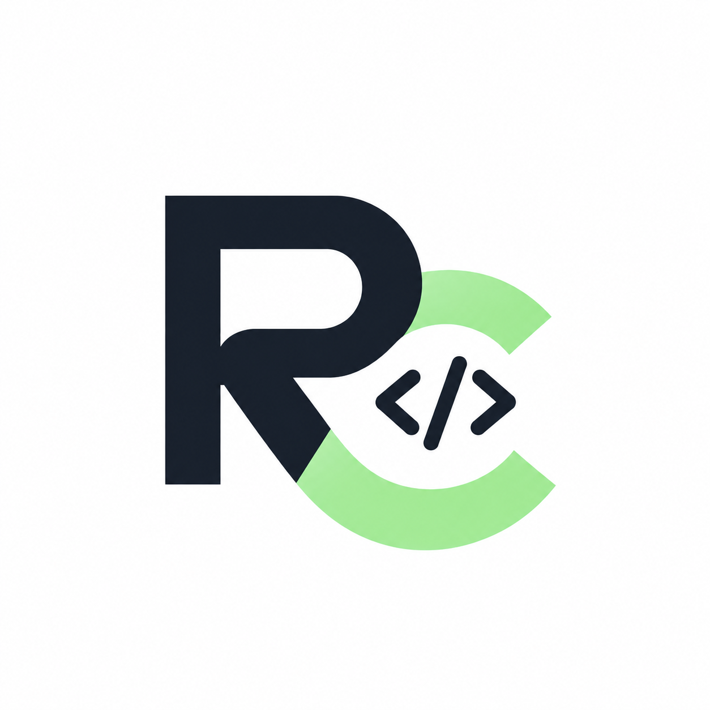
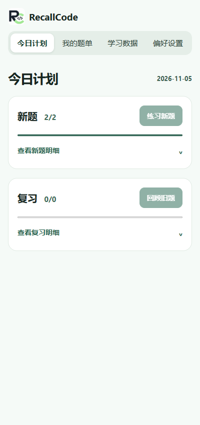
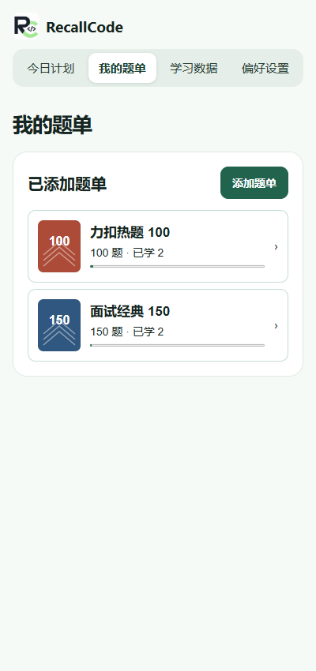
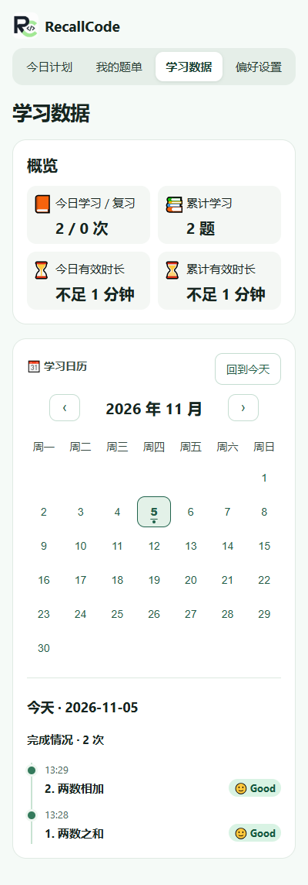
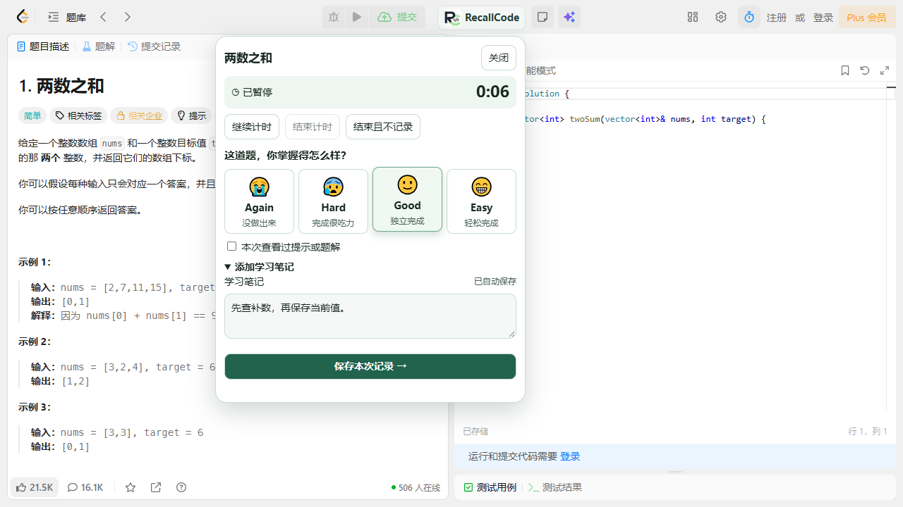
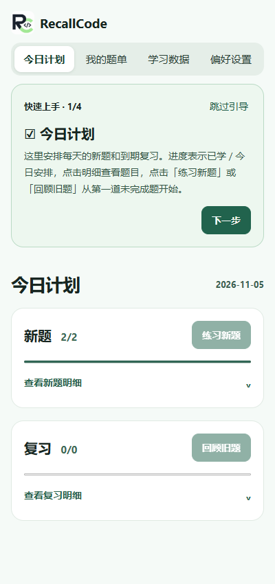

  

<h1 align="center">RecallCode</h1>

每天练一点，让做过的算法题真正记得住。

  <a href="https://github.com/userlyly/RecallCode/releases/tag/v2.0.0">下载安装包</a> ·
  <a href="#快速安装">快速安装</a> ·
  <a href="#开始使用">开始使用</a> ·
  <a href="https://github.com/userlyly/RecallCode/issues">反馈问题</a>

## RecallCode 是什么

RecallCode 是一款免登录、离线优先的力扣学习与间隔复习浏览器插件。它把「选题、练习、记录、复习」连在一起，让你打开侧栏就知道今天练什么，在力扣题页完成计时、笔记和自我评分。

适合正在刷力扣、准备面试，以及希望定期回顾已学题目的开发者。日常使用只需浏览器，学习记录保存在本机。

## 为什么用 RecallCode

| 你遇到的情况 | RecallCode 提供的帮助 |
| --- | --- |
| 做过很多题，过一阵又忘了 | FSRS 根据每次评分更新复习间隔，让题目在到期时回到计划中 |
| 每天不知道从哪道题开始 | 新题和复习分别设置每日上限，一键打开第一道未完成题 |
| 中断几天，积压越来越多 | 重新选择当日到期题，按优先级和上限分批安排 |
| 题单里反复遇到相同题目 | 跨题单共享学习进度，同一道题统一记录 |
| 练习和记录来回切换 | 在力扣「提交」旁打开 RecallCode，直接计时、记笔记和评分 |
| 希望掌握自己的数据 | 本机保存，无需注册，支持 JSON 备份、恢复和 v1 数据迁移 |

内置 **力扣热题 100、面试经典 150、SQL 50**，共三份完整题单。也可以创建个人题单，通过公开链接或批量粘贴导入。删除题单后，已有学习记录仍会保留。

## 看看实际界面

以下截图来自真实 Chrome 扩展测试。封面为 AI 绘制的项目介绍图。

<table>
  <tr>
    <td align="center"><b>今日计划</b> 新题与复习进度，点击展开明细</td>
    <td align="center"><b>我的题单</b> 内置题单与个人题单，共享学习进度</td>
    <td align="center"><b>学习数据</b> 题量、有效时长、日历与完成记录</td>
  </tr>
  <tr>
    <td></td>
    <td></td>
    <td></td>
  </tr>
</table>

**在力扣题页完成训练记录**

点击「提交」旁的 RecallCode 按钮，打开计时与评分面板。结束训练后选择 😭 没做出来、😰 完成很吃力、🙂 独立完成或 😁 轻松完成，还可以保存解题思路与易错点。

## 快速安装

### 直接下载安装包

1. 前往 [v2.0.0 发布页](https://github.com/userlyly/RecallCode/releases/tag/v2.0.0)，下载附件 **recallcode-v2.zip**。
2. 将 ZIP 解压到固定文件夹。
3. 桌面 Chrome 地址栏打开 <code>chrome://extensions</code>，打开右上角「开发者模式」。
4. 点击「加载已解压的扩展程序」，选择刚才解压后包含 **manifest.json** 的文件夹。
5. 在浏览器扩展菜单中固定 RecallCode，然后点击它打开侧栏。已有力扣题页请刷新一次。

安装完成后即可使用。请保留解压目录，浏览器会从该目录读取插件文件。

### 从源码构建

需要 **Node.js 24 或更高版本** 和 npm。

~~~sh
git clone --branch feature/recallcode-v2-extension https://github.com/userlyly/RecallCode.git
cd RecallCode/extension
npm ci
npm run build
~~~

然后按上面的 Chrome 安装步骤，选择生成的 **extension/dist** 目录。

## 开始使用

1. **完成首次设置**。选择题单、历史学习状态以及每日新题和复习上限。默认每天 2 道新题、最多 10 道复习，随后会介绍四个页面。
2. **让题单参与计划**。进入「我的题单」，点开卡片，点击「点击参与今日计划」。已参与的题单会显示勾选状态。
3. **开始今天的练习**。在「今日计划」查看已学/今日安排。点击「练习新题」或「回顾旧题」打开第一道未完成题，也可以展开明细查看进度。
4. **记录一次真实训练**。在力扣题页点击 RecallCode，按需暂停或结束计时，选择四档评分后点击保存。评分是安排下次复习的依据。
5. **回顾与备份**。在「学习数据」查看日历和完成记录，在「偏好设置」调整每日题量、导出 JSON。新手引导也可以在设置中重新打开。

查看首次使用引导

## 每日计划如何安排

- **新题**从参与计划的题单中选取，跨题单去重后按题号顺序安排，受每日新题上限约束。
- **复习**从已到期的题目中选取，综合逾期天数和上次评分排序。旧版迁入且尚未评分的历史题也占复习名额。
- **按日期到期**。以偏好中保存的本地时区为准。若间隔为 1 天，昨晚 21:00 学习，次日零点起就可进入复习计划。间隔天数由 FSRS 根据评分计算。
- **中断后继续**。重新计算当天的到期队列，按每日上限逐步安排积压。当日已完成的题目会从待办中移出，跨题单进度同步。
- **主动评分**。完成力扣提交后，仍需在 RecallCode 中主动评分并保存，才会更新复习安排。

当前使用锁定的 ts-fsrs@6.0.0 和 FSRS-6，默认目标保持率为 0.9。每道题保存独立的记忆状态与复习记录。

## 题单导入与数据

**公开题单**支持力扣中国站和国际站链接。解析时核对真实题目、编号与完整性，遇到登录、验证、分页或页面结构限制时会说明原因，可以改用批量粘贴。不同公开题单的自动读取效果取决于页面可访问性。

**本机数据**使用 IndexedDB 保存题单、进度、评分与笔记，Chrome Storage 保存插件设置。侧栏和力扣页共用记录。已加载的题页可以在断网时保存训练，访问力扣或读取公开题单仍需联网。

**备份与迁移**支持导出 JSON、合并恢复以及导入 RecallCode v1 导出文件。卸载、清理浏览器扩展数据或更换扩展 ID 可能丢失本机记录，请定期备份。v1 导出缺失的题单关系、超出源导出上限的历史记录无法补回，迁移前会提示。

## 浏览器支持与已知限制

| 环境 | 当前状态 |
| --- | --- |
| 桌面 Chrome | Manifest V3，构建目标 114+，实测 Chrome for Testing 156.0.8078.4 |
| Edge | 基于 Chromium，尚未完成实机验收 |
| Firefox | 需要适配侧栏和后台 API |
| IE / 移动端浏览器 | 当前不支持 |

- 主要实测站点为力扣中国站。国际站题页已配置入口，完整流程仍受站点验证影响，尚待验收。
- 公开题单可能无法自动获取，此时可使用批量粘贴。
- 目前提供本机存储与手动备份。
- 浏览器测试对中国站权限进行了预授予，原生授权弹窗和物理工具栏点击仍需人工验证。

## 开发与测试

~~~sh
cd extension
npm ci
npm test
npm run build

# 首次运行浏览器测试时安装 Chromium
npx playwright install chromium
npm run test:browser
~~~

本次验证通过 **24 项自动化测试**和真实 Chrome 端到端测试，覆盖日期边界、夏令时、题单去重、FSRS 评分、离线保存、浏览器重启、备份恢复、首次引导与侧栏交互。浏览器测试访问真实力扣公开页面，网络和页面变化可能影响结果。

| 目录 | 内容 |
| --- | --- |
| extension/src/ | React 侧栏、每日计划、FSRS、存储和训练逻辑 |
| extension/public/ | Manifest V3、力扣内容脚本与图标 |
| extension/tests/ | 自动化测试和真实浏览器验证 |
| docs/images/ | README 介绍图与真实截图 |
| app/ | RecallCode v1 网站代码 |

更详细的构建、权限和迁移说明见 [插件使用文档](extension/README.md)。旧版网站的运行方式已整理到 [RecallCode v1 文档](docs/RECALLCODE_V1_WEB.md)。

如果 RecallCode 帮你形成了持续练习的习惯，欢迎点个 **Star**，也欢迎通过 [Issues](https://github.com/userlyly/RecallCode/issues) 反馈问题。

本项目是独立开发的学习工具。题目在力扣网站练习，内置题单仅包含题目元数据。
